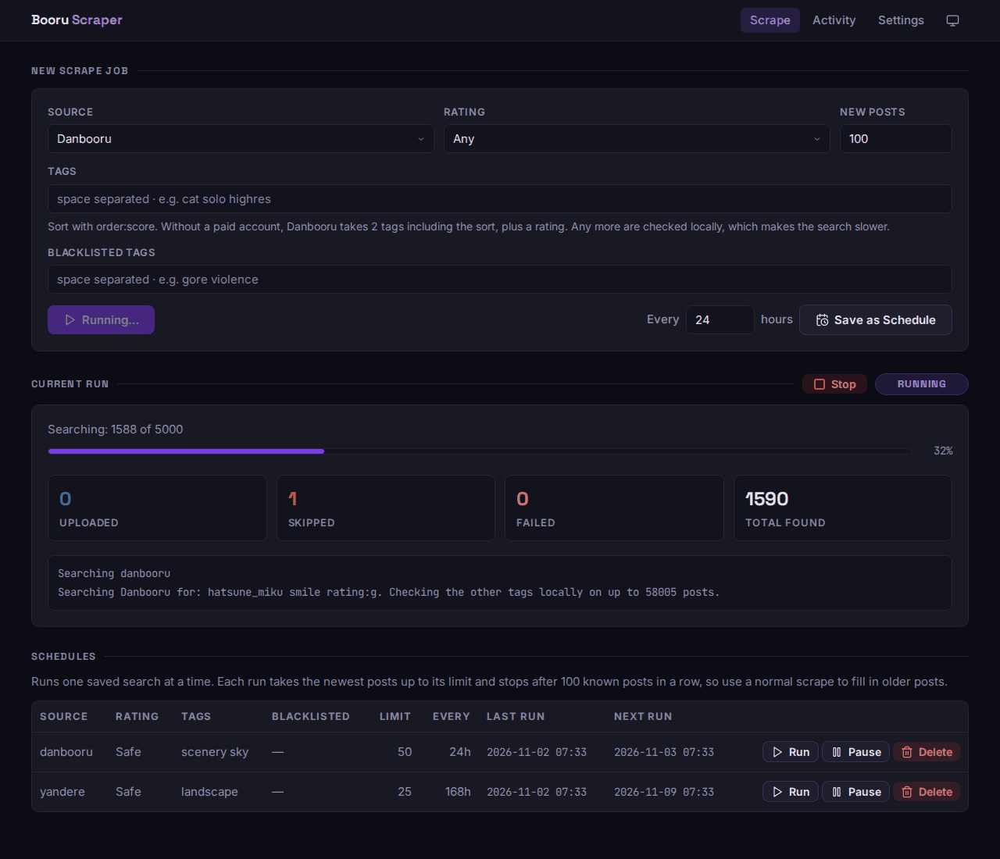
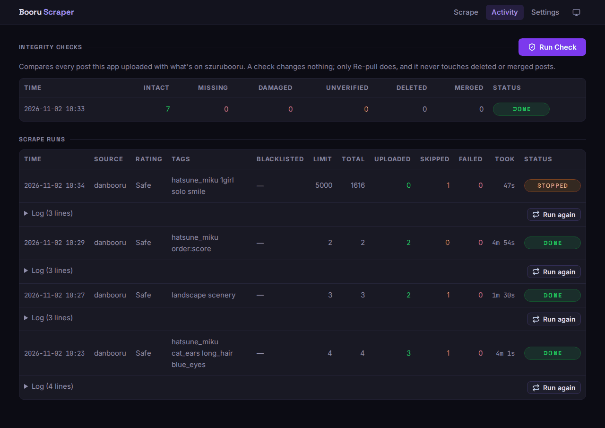
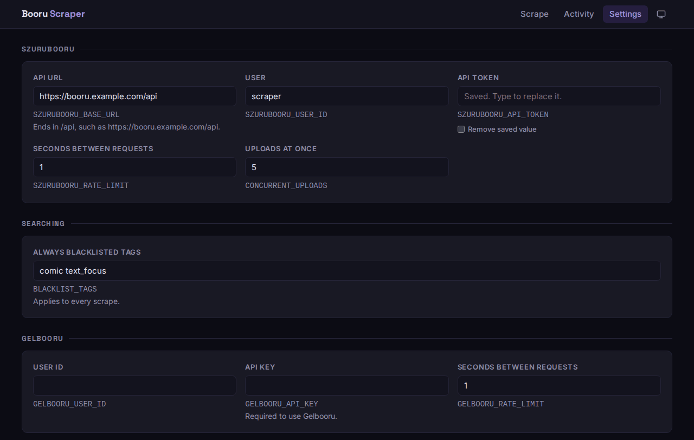

# booru-scraper

<!-- BADGES:START -->
[](https://gitea.rkahome.work/SleepyShoggoth/booru-scraper/actions/workflows/tests.yml) [Open tracker issues](https://gitea.rkahome.work/SleepyShoggoth/homelab-tracker/issues?q=booru-scraper&type=all&state=open) [Pending Renovate PRs](https://gitea.rkahome.work/SleepyShoggoth/booru-scraper/pulls?type=all&state=open&q=renovate)
<!-- BADGES:END -->

Pull posts from booru-style image boards into your self-hosted [szurubooru](https://github.com/rr-/szurubooru). Start a scrape from your browser, watch it live, and let the app handle tags and duplicates.



## Features

**Scraping**

- Gelbooru, Danbooru, Yandere, e621 and Rule34
- Filter by rating and tags, with a blacklist per scrape or for every scrape
- Live progress and logs, with a stop button
- Danbooru searches past the free account's 2-tag limit

**Your library**

- No duplicates: posts are matched by MD5 and source ID, and the same file from another source adds its tags and link to the existing post
- New tags are created with the right categories
- Integrity checks find missing or damaged posts, and tell them apart from ones you deleted or merged

**Running it**

- Saved searches on a schedule, which pick up what's new and stop
- Run history, with retry and run again
- Settings page, with keys and tokens encrypted in the database
- Optional password login and Apprise notifications
- Light and dark themes

## Quick start

You'll need Docker with Compose, and a szurubooru instance with an account that can create posts.

1. Create your `.env`:

   ```bash
   cp .env.example .env
   ```

   Change the database password, and set `SETTINGS_KEY` to the output of `openssl rand -hex 32`.

2. Choose how to protect the app, also in `.env`. Settings stay read-only until you do:

   - Set `APP_PASSWORD` for a password login, or
   - Set `ALLOW_SETTINGS_WITHOUT_LOGIN=true` if a [login proxy or a trusted network](docs/login-and-security.md) already protects it

3. Start it:

   ```bash
   docker compose up -d
   ```

4. Open `http://localhost:8192`, go to **Settings**, and enter your szurubooru details and any source keys.

To build the image from source instead, run `docker compose up -d --build`.

## Screenshots

| Activity | Settings |
| --- | --- |
|  |  |

## Documentation

| Guide | Covers |
| --- | --- |
| [Configuration](docs/configuration.md) | Every setting, and how secrets are stored |
| [Sources](docs/sources.md) | What each source needs, its limits, and Danbooru's tag limit |
| [Login and security](docs/login-and-security.md) | Passwords, proxies and exposing the app |
| [Notifications](docs/notifications.md) | Apprise setup and events |
| [Troubleshooting](docs/troubleshooting.md) | Why a run stopped, known quirks, health check |
| [Upgrading](docs/upgrading.md) | Updating and going back a version |
| [Development](docs/development.md) | Running locally, tests, migrations, adding a source |

## Recent changes

<!-- CHANGES:START -->
_No releases yet._ [Releases](https://gitea.rkahome.work/SleepyShoggoth/booru-scraper/releases)
<!-- CHANGES:END -->

## Contributing

<!-- CONTRIBUTING:START -->
Feature branch → pull request → conventional commits → CI releases and deploys. See [CONTRIBUTING.md](https://gitea.rkahome.work/SleepyShoggoth/actions/src/branch/main/CONTRIBUTING.md) in `actions`.
<!-- CONTRIBUTING:END -->

## License

AGPL-3.0 — see [LICENSE](LICENSE).

The fonts in `app/static/fonts` are under the SIL Open Font License, with each font's license file next to it. The icons in `app/static/icons` are from [Lucide](https://lucide.dev), under its ISC license.
