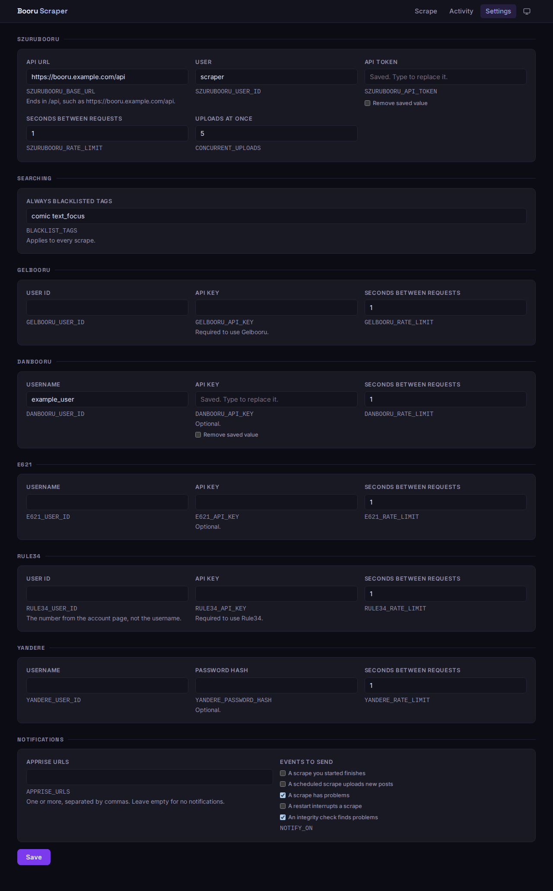

# Configuration

Most settings live on the app's **Settings** page and apply without a restart. A few have to stay in `.env`, because the app needs them before it can read its database or decide who may log in.

## `.env` settings

| Name | Purpose |
| --- | --- |
| `DB_USER`, `DB_PASS`, `DB_NAME` | Postgres credentials, used by both containers |
| `DB_HOST`, `DB_PORT` | Where Postgres is, for running without Compose |
| `SETTINGS_KEY` | Encrypts keys and tokens saved on the Settings page. `openssl rand -hex 32` makes one |
| `APP_PASSWORD` | Turns on the login page. See [Login and security](login-and-security.md) |
| `ALLOW_SETTINGS_WITHOUT_LOGIN` | Allows editing settings with no `APP_PASSWORD`. See [Login and security](login-and-security.md) |
| `COOKIE_SECURE` | Set to `true` once the app is served over HTTPS |
| `TZ` | Timezone for displayed times, such as `America/Chicago`. Times are stored in UTC either way |
| `LOGLEVEL` | Log verbosity, `INFO` by default |

## The Settings page

| Group | What it holds |
| --- | --- |
| Szurubooru | API URL ending in `/api`, user, API token, request delay, uploads at once |
| Searching | Tags blacklisted on every scrape, on top of the ones in the form |
| Sources | Each source's credentials and request delay. See [Sources](sources.md) |
| Notifications | Apprise URLs and which events to send. See [Notifications](notifications.md) |

The Szurubooru account needs permission to create posts. Merging duplicates and linking related posts also need permission to edit them; without it, runs carry on and log a warning.

Saving waits for any running scrape or integrity check to finish.

## Using `.env` for page settings

Every setting can also be set in `.env` under the name shown beneath its field. A value in `.env` takes priority, and the page shows it as locked. Installs that already keep everything in `.env` carry on working without changes.

## How secrets are stored

Keys, tokens and Apprise URLs are encrypted in the database with `SETTINGS_KEY`, and are never sent back to the browser.

- This protects a copy of the database on its own. Anyone with both the database and `.env` can read the values, so keep `.env` private.
- It's fine to back up `.env` alongside the database, the usual approach for self-hosted apps.
- If `SETTINGS_KEY` is lost or changed, the app still starts, and the page asks for those values again.
- Changing the Szurubooru URL requires entering the token again, so a saved token can't be sent to another server.
